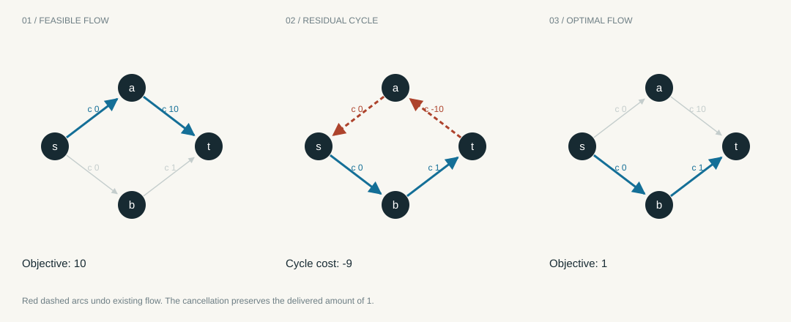

# Min-cost flow lab

**[View the report in your browser](https://Michaelhoang8.github.io/min-cost-flow-lab/)**

An exact integer flow solver with an independently checkable result: capacity and flow conservation checks, residual-potential optimality certificates, and capacity-cut infeasibility certificates. It implements its own breadth-first feasibility search and Bellman–Ford negative-cycle cancellation in Python's standard library.

The repository contains source, executable tests, synthetic networks, actual solve traces, a preserved exhaustive-oracle corpus, and a generated [technical report](docs/report.html). This is an AI-assisted engineering exercise; datasets and scenarios are synthetic.



## What is implemented

- Fixed source-to-sink demand with integer capacities and positive or negative integer costs.
- Separate identities for parallel and antiparallel arcs; reverse residual edges undo original flow.
- Negative cycles in disconnected components, including when required transfer is zero.
- Explicit `OPTIMAL`, `INFEASIBLE`, and `UNKNOWN` outcomes. Exhausting the cancellation budget never means infeasible or optimal.
- A verifier that uses neither the solver's path search nor its cycle detector.
- Exact trace replay, certificate corruption tests, CLI exit-code tests, 650 small exhaustive comparisons, and an independent full-size boundary test.

This is a deliberately small one-commodity model: 2–32 nodes, at most 128 arcs, finite capacities 0–10,000, costs −10,000–10,000, demand 0–10,000. Self-loops, lower bounds, fractional flows, multiple commodities and unbounded capacities are unsupported.

## Run

Python 3.13; no runtime, plotting, or test dependencies.

```bash
python -m unittest discover -s tests -v
python -m flowlab examples/transportation.json --output build/transportation.json
python -m flowlab examples/transportation.json --verify build/transportation.json
python scripts/verify_results.py
python scripts/run_study.py --output-dir build/reproduction
```

Open `docs/report.html` directly, or the fresh `build/reproduction/docs/report.html`. HTML uses local SVG files and no network resources. Running the study without `--output-dir` replaces the preserved study outputs with a new genuine run; timing rows and UTC metadata will change.

CLI exits: **0** optimal / certificate valid; **2** invalid input or I/O; **3** infeasible; **4** budget-limited unknown. Verification of a valid `UNKNOWN` result exits 0 because its feasible-incumbent claim checks, not because it is optimal.

```bash
python -m flowlab examples/reverse_rerouting.json --cycle-budget 0
python -m flowlab examples/infeasible_cut.json
```

## Actual results

| Scenario | Result | Delivered / required | Objective |
|---|---|---:|---:|
| Reverse rerouting | OPTIMAL | 1 / 1 | 1 |
| Bottleneck | OPTIMAL | 4 / 4 | 9 |
| Infeasible cut | INFEASIBLE | 4 / 5 | 14¹ |
| Transportation | OPTIMAL | 10 / 10 | 20 |
| Disconnected circulation | OPTIMAL | 2 / 2 | 0 |
| Parallel arcs | OPTIMAL | 3 / 3 | 7 |
| Zero cancellation budget | UNKNOWN | 1 / 1 | 10² |
| Zero required transfer | OPTIMAL | 0 / 0 | −6 |

¹ Cost of the returned partial maximum flow, **not** a minimum-cost four-unit claim. Feasibility failure is returned before cost optimization.

² Cost of a feasible incumbent. A negative cycle remains.

The transportation fixture reaches cost 20 with two cancellations. The small rerouting fixture starts at 10, uses two reverse residual edges, and reaches 1. These are exact synthetic-model objectives, not business savings.

The recorded run includes 120 additional oracle networks with 5,000 enumerated assignments and 25 observed solve calls per fixed scenario, after three untimed warmups. Timings include trace allocation and exclude parsing/verification. Tiny local timings are not production performance estimates.

## Review the evidence

- [Input networks](examples/) and [complete flows, certificates and traces](results/cases/)
- [Preserved oracle corpus](results/oracle-corpus.json), [timing CSV](results/timings.csv), [environment](results/environment.json), [test output](results/test-results.txt)
- [Artifact and source SHA-256 hashes](results/provenance.json)
- [Algorithm and certificate reasoning](docs/algorithm.md)
- [Input format and API](docs/format.md)
- [Measurement and reproducibility](docs/methodology.md)
- [Report screenshots](docs/screenshots/README.md) and [recorded report review](docs/recordings/README.md)

Cycle cancellation is easy to audit but can require pseudopolynomial work. The explicit budget bounds improvement steps; it is not a wall-clock timeout. The implementation is suitable for bounded educational experiments, not a production optimization service.
